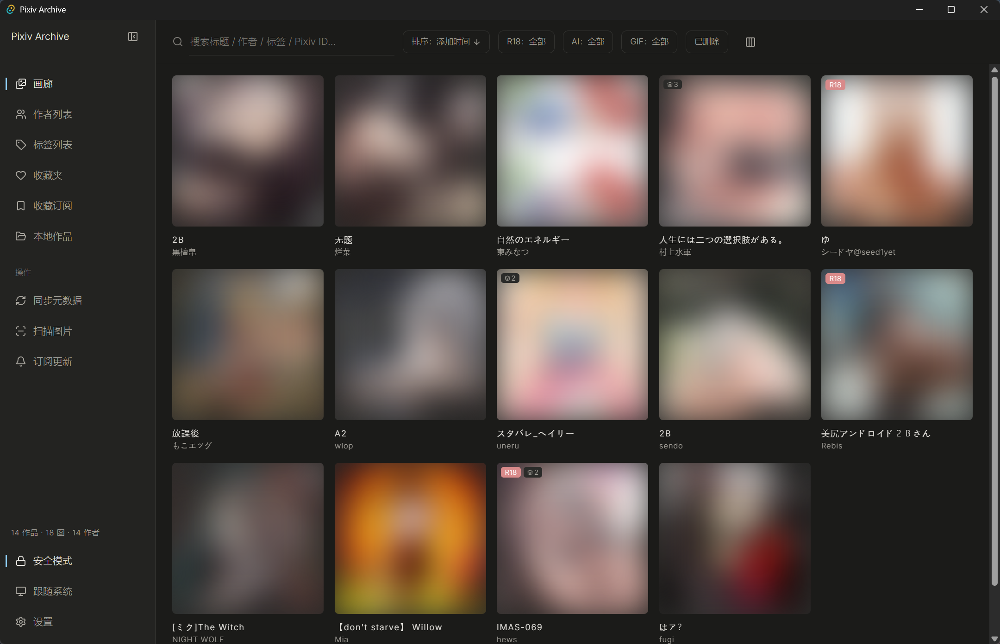
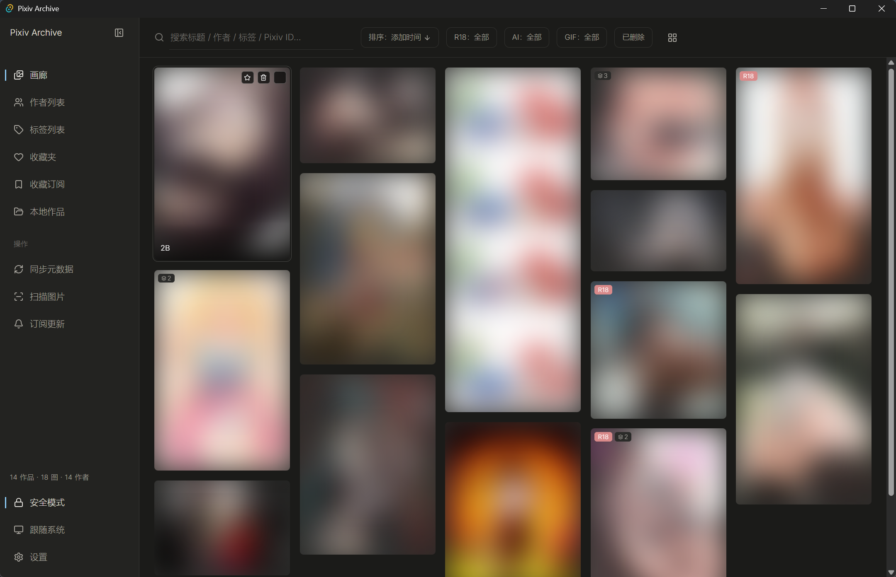
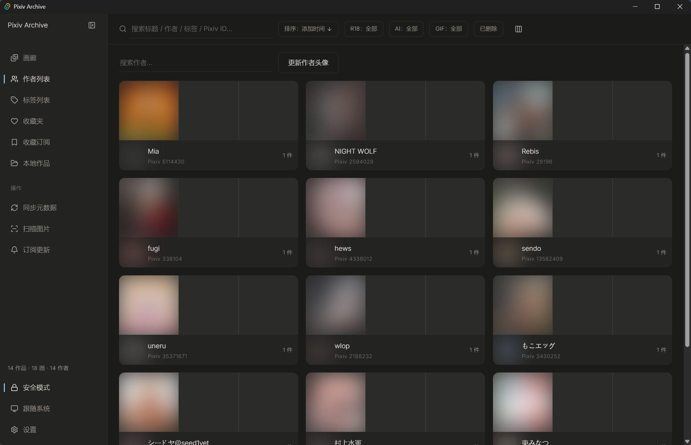
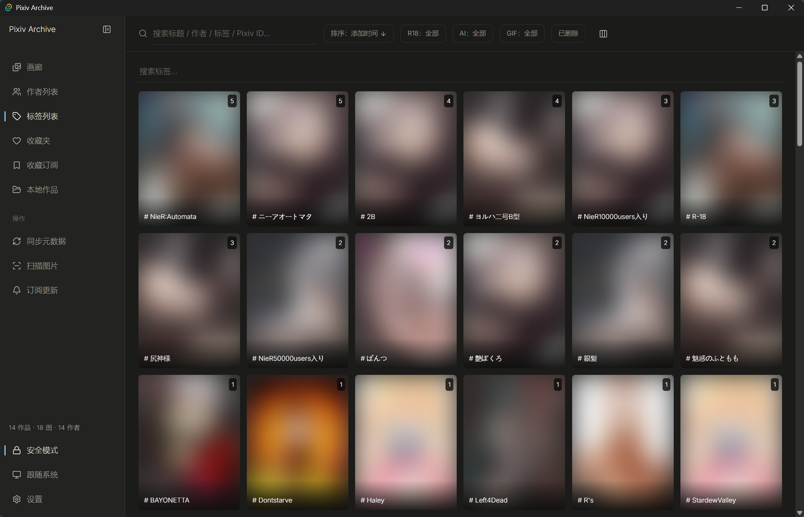

# Pixiv Archive

本地 Pixiv 作品收藏管理与浏览工具。

把你下载到硬盘上的 Pixiv 图片整理成一个可搜索的本地资料库：自动识别作品、生成缩略图、按作者和标签归类，还能联网补全作品信息、订阅别人的公开收藏或某位作者自动下载新作品。

完全本地运行，不需要服务器，也不会上传任何东西。

- **旧Python项目用户请使用 `设置-数据迁移` 中的 `导入旧项目数据` 功能导入数据”**

| 网格布局 | 瀑布流布局 |
| :---: | :---: |
|  |  |

| 作者列表 | 标签列表 |
| :---: | :---: |
|  |  |

## 功能

- **扫描入库**：选一个图片目录，自动识别文件名里的 Pixiv 作品 ID，建立资料库并生成缩略图。
- **浏览**：网格 / 瀑布流两种布局，可按添加时间、发布时间排序，支持 R18、AI、动图筛选，也能直接搜标题、作者、标签或 Pixiv ID。顶栏「随机」按钮会打乱一次当前列表（不影响排序下拉框），排序选择会记住上次关闭时的状态。
- **统一搜索**：顶栏搜索框跟着页面切换范围——画廊 / 本地收藏 / 本地作品搜作品，作者列表搜作者，标签列表搜标签。本地搜不到时会非阻塞地再查 Pixiv：作者结果可以直接订阅，作品结果可以直接下载入库；没网时只提示「无法连接 Pixiv」，本地结果照常可用。
- **作品详情**：多图作品可翻页、滚轮缩放、拖拽查看；一键收藏、删除；点作者名直接进作者页，点标签进标签列表。
- **作者 / 标签 / 本地收藏**：自动聚合作者与标签；作品删完后，没有作品的作者和标签会自动从列表里消失。本地收藏可以自由归类作品。作者列表可以「仅看收藏」（排除作者订阅下载带来的新作者，默认开启）或「仅看已订阅」；已订阅的作者自动置顶，取消订阅时当前卡片不会立刻跳位。进入某位作者后，「仅看收藏」只显示你在 Pixiv 收藏的作品，点旁边的按钮可以切回全部。
- **元数据同步**：联网补全标题、作者、标签、发布日期等信息；作者改名或换头像后重新同步会跟着更新；作品在 Pixiv 上已删除或作者设为非公开时，会标记为「已隐藏」并从列表里收起，顶栏「已隐藏」可以查看。
- **订阅列表**：订阅别人的公开收藏，也可以订阅某位作者的作品；检查时自动下载新作品，并完成入库、缩略图、元数据一整套流程；动图会自动合成为 GIF。作者订阅默认只收录订阅之后发布的新作品，添加时可勾选「补全该作者已有作品」。
- **同步 Pixiv 收藏**：读取你自己账号的公开 + 私密收藏（只在本机记录作品 ID），作者列表的「仅看收藏」就能按真实收藏筛选，把作者订阅下载、你并没有收藏的作品作者收起来。
- **下载可靠**：支持断点续传和失败重试，下载队列会保存进度，关掉程序再打开也能接着下；多页作品会并发下载。
- **图片校验**：下载和订阅检查都会和 Pixiv 的页数核对，已齐全的作品直接跳过，缺页的只补缺失页；侧栏「校验图片」可以全库检查并补齐缺页。
- **并行任务**：同步元数据和订阅下载可以同时进行，不用等一个跑完再开另一个。
- **作者头像**：自动下载作者头像，也可以在作者页一键批量更新。
- **数据迁移**：把资料库、缩略图、元数据打包成一个文件，换电脑时导入即可还原；也能一键导入旧版本的数据。
- **安全模式**：开启后所有图片自动模糊，适合在公共场合浏览。

## 界面导览

左侧栏是主要入口：

| 入口 | 作用 |
| --- | --- |
| 画廊 | 全部作品，顶部可以搜索、排序和筛选 |
| 作者列表 | 按作者浏览，点进去是该作者的全部作品；可筛选仅看收藏 / 仅看已订阅，也能同步自己的 Pixiv 收藏 |
| 标签列表 | 按标签浏览 |
| 本地收藏 | 自己建的分组，用来归类作品 |
| 订阅列表 | 订阅的 Pixiv 用户（公开收藏）或作者，检查后自动下载新作品 |
| 本地作品 | 文件名里认不出 Pixiv ID 的图片会归到这里 |

侧栏底部是操作区：**同步元数据**（联网补全信息）、**扫描图片**（把新下载的图片入库）、**订阅更新**（检查所有订阅）、**校验图片**（按 Pixiv 页数补齐缺页）、**安全模式**、**主题切换**、**设置**。

点开任意作品进入查看器：多图作品可以翻页，滚轮缩放、拖拽移动，也能收藏、删除，或者跳到作者页和标签页。

## 安装与运行

本软件是绿色版，不需要安装：

1. 把 `pixiv-archive-desktop.exe` 放到任意文件夹（例如 `D:\PixivArchive\`），不要放在 Program Files 这类需要管理员权限的目录。
2. 双击运行。首次启动会在 exe 旁边生成 `data` 文件夹，用来存放资料库、缩略图、头像和设置。
3. 想搬家或备份时，把整个文件夹拷走即可，所有数据都跟着走。

系统要求：Windows 10 1803 或更新版本。系统一般自带 WebView2 运行时，如果没有，装一下微软官方的 WebView2 Runtime 即可。

## 第一次使用

1. **设置图片目录**：点左下角「设置」→「基础」，选择存放 Pixiv 图片的文件夹。
2. **填写 Pixiv Token**（可选，但同步和订阅都需要）：设置 →「网络」，粘贴你的 Pixiv refresh token；同一页还可以设置代理、镜像、请求间隔和同时下载数。请求间隔默认 200 毫秒，网络不稳或被限流时调大一些会更稳。
3. **扫描**：点侧栏「扫描图片」，确认目录后开始，扫描完成后画廊里就有作品了。
4. **补全信息**：点侧栏「同步元数据」，程序会联网补全标题、作者、标签等信息。
5. **订阅**：进入「订阅列表」，先选订阅类型（收藏 / 作者），再输入用户 ID，添加后点「检查」，新作品会自动下载。作者列表里也可以直接点作者卡上的「订阅」。

## 图片文件怎么命名

扫描靠文件名识别作品，所以文件名里需要包含 **7–10 位的 Pixiv 作品 ID**：

- 单图：`123123.png`、`[作者名] 123123.jpg`
- 多图：`123123_p0.png`、`123123_p1.png`、`123123_p2.png`

认不出 ID 的图片也会入库，但只能作为「本地作品」浏览，无法同步元数据、也无法归到作者名下。

## 数据与隐私

- 所有数据都在本机，程序不提供任何对外服务，也不监听端口。
- 联网只发生在「同步元数据」「订阅检查」和「更新作者头像」时，用的都是你自己填写的 Pixiv refresh token；token 保存在本机的 `settings.json` 里。
- 作品、缩略图、本地收藏、订阅等全部存在 exe 旁边的 `data\` 文件夹：`library.db` 是资料库，`thumbnails\` 是缩略图，`avatars\` 是作者头像，`raw\` 是同步到的原始元数据备份，`settings.json` 是设置。
- 开启「安全模式」后，所有图片都会模糊显示，退出程序后设置仍然保留。

## 常见问题

**扫描很慢？**
第一次扫描需要读取每个文件生成缩略图，会比较久；之后再扫同一目录会快很多，只处理新增文件。

**缩略图是空白 / 图片显示不出来？**
先确认图片文件还在原位置。如果移动过图片目录，可以在 设置 →「数据迁移」里点「重新关联图片路径」，程序会按文件名把资料库里的旧路径改到当前目录。

**搜索找不到？**
先在本地搜；本地没有结果时会自动去 Pixiv 再搜一次，结果显示在本地结果下面。没网或代理不可用时只会提示「无法连接 Pixiv」，不弹错误，本地结果仍然可用。

**作品图片不全（多图作品少了几页）？**
点侧栏「校验图片」，程序会按 Pixiv 上的页数逐件核对，只补缺失的页；订阅检查时也会自动做这一步，齐全的作品不会重复下载。

**有些作品在 Pixiv 上变成非公开 / 删除了？**
同步元数据或订阅检查会识别 Pixiv 返回的 `visible=false`，把这些作品标记为「已隐藏」，默认不出现在画廊、作者和标签列表里；点顶栏的「已隐藏」可以查看。已隐藏的作品不会再下载占位图。

**同步失败、报网络错误？**
先检查网络和代理。设置 →「网络」里可以选「直连」「指定代理」或「跟随系统代理」，代理地址填你本机的代理端口（例如 `http://127.0.0.1:7897`）。

**下载到一半断了，或者程序被关掉？**
重新点「订阅更新」即可。已下好的图片和未完成的临时文件都会保留，程序会跳过已完成的部分接着下；失败的条目会按时间自动重试，不需要手动清理。

**一次更新订阅为什么下了几百件？**
每个订阅一次最多处理 500 件待下载队列，进度浮窗会显示「待下载 N」。这些是之前没下完的收藏或作者历史，不是每次重新下载同一批；队列清空后，每次只会下载新作品。

**关闭窗口会怎样？**
直接退出程序。如果正在扫描或同步，任务会中断，建议等任务跑完再关闭。

**重复打开会怎样？**
不会开第二个窗口，只会把已经打开的窗口提到最前面。

**删除作品会不会删掉原图？**
默认只从资料库里移除。删除确认框里勾选「同时删除本地源文件」才会真的删硬盘上的图片，请谨慎勾选。

**换电脑 / 重装系统怎么办？**
在旧电脑上用 设置 →「数据迁移」→「导出数据包」，把生成的 zip 带到新电脑，再用「导入数据包」还原即可，不需要重新扫描和同步。

## 从源码构建（进阶）

```bash
pnpm install
pnpm tauri dev                    # 开发运行
pnpm tauri build --no-bundle      # 打包便携版 exe
```

产物在 `src-tauri/target/release/pixiv-archive-desktop.exe`。